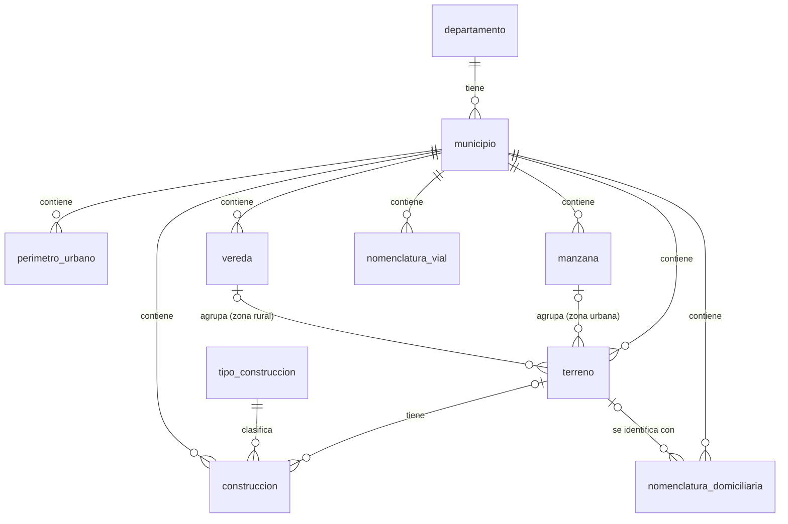

# VECTORIAL · Visor catastral del Quindío (SIG Web con PostgreSQL/PostGIS)

Tarea integradora — Programación para SIG · Ingeniería Topográfica y Geomática · Universidad del Quindío
Autor: Neider Camilo Verano Vidales · ncveranov@uqvirtual.edu.co

Visor web que consulta una geodatabase **PostgreSQL/PostGIS** con la base catastral oficial del Quindío (11 municipios) mediante una API **FastAPI + Psycopg** y la representa en **Leaflet**. Todo el contenido del mapa sale de consultas SQL/PostGIS ejecutadas en el momento; el frontend no trae ningún GeoJSON fijo ni datos simulados.

---

## 1. Objetivo y alcance

**Objetivo.** Consultar y analizar la información catastral del departamento (terrenos, construcciones, manzanas, veredas y nomenclatura) y responder preguntas de un profesional de topografía o catastro: *¿qué predio hay en este punto?, ¿qué hay a menos de 100 m?, ¿cómo está construido un municipio?*

**Alcance.**
- Cobertura: los 11 municipios del Quindío incluidos en la base catastral del IGAC (**Armenia no está en la fuente**, ver §11).
- El mismo esquema y el mismo cargador sirven para cualquier otro departamento descargando su geodatabase (`scripts/cargar_gdb.py --departamento 05`).
- No es una herramienta de levantamiento: los datos son los de la base catastral y se usan con fines de consulta.

## 2. Fuentes de información

| Dato | Fuente | Notas |
|---|---|---|
| Terrenos, construcciones, manzanas, veredas, perímetros urbanos, nomenclatura vial y domiciliaria | Base catastral vectorial del Quindío (IGAC / DANE), geodatabase departamental `63.gdb` (archivo `63_gdb.7z`) | Sistema de referencia **MAGNA-SIRGAS / Origen Nacional (EPSG:9377)**. Enlace de descarga: [Datos abiertos IGAC - Base catastral vectorial](https://datos-abiertos-igac-igac-oit.hub.arcgis.com/datasets/cd3d983dfda94302807af70f88cd50c8/about) (geoportal de datos abiertos del IGAC) |
| Códigos y nombres de municipios y departamentos | DANE, Marco Geoestadístico Nacional (MGN 2018), tomado del paquete npm `@john-guerra/geo-colombia` 0.1.0 (licencia MIT) | Archivo `datos/divipola.json` |
| Mapa base | © colaboradores de OpenStreetMap; imágenes © Esri | Solo como fondo del visor |

**Los datos catastrales no se incluyen en el repositorio** (la geodatabase pesa unos 100 MB). El procedimiento para obtenerlos y cargarlos está en §5.

## 3. Arquitectura

```
Navegador (HTML + CSS + JavaScript + Leaflet)                 frontend/
      │  fetch() → HTTP GET, respuesta JSON / GeoJSON
      ▼
API FastAPI (Python)                                          backend/app/main.py
      │  consultas parametrizadas (Psycopg 3 + pool)          backend/app/db.py
      ▼
PostgreSQL 16 + PostGIS 3.4  (esquema "catastro", EPSG:9377)  db/
```

- **Frontend** (`frontend/`): `index.html` (estructura), `css/estilos.css`, `js/api.js` (llamadas HTTP), `js/visor.js` (mapa y capas Leaflet), `js/paneles.js` (consultas e interfaz).
- **Backend** (`backend/app/`): `main.py` (endpoints), `sql.py` (**todas las consultas SQL**), `db.py` (conexión Psycopg), `geojson.py` (construcción del GeoJSON), `config.py` (lee `.env`).
- **Base de datos** (`db/`): `01_esquema.sql`, `02_post_carga.sql`, `03_consultas_verificacion.sql`.
- La API también sirve el frontend, por lo que basta con un solo servidor: `http://127.0.0.1:8000`.

## 4. Modelo relacional

Esquema `catastro`, 10 tablas, 8 con geometría. Detalle de cada columna en [`docs/diccionario_datos.md`](docs/diccionario_datos.md).



| Tabla | Geometría | Clave primaria | Claves foráneas |
|---|---|---|---|
| `departamento` | — | `codigo` | — |
| `municipio` | MultiPolygon | `codigo` | `departamento_codigo` |
| `perimetro_urbano` | MultiPolygon | `globalid` | `municipio_codigo` |
| `vereda` | MultiPolygon | `codigo` | `municipio_codigo` |
| `manzana` | MultiPolygon | `codigo` | `municipio_codigo` |
| `terreno` | MultiPolygon | `codigo` | `municipio_codigo`, `manzana_codigo`, `vereda_codigo` |
| `tipo_construccion` | — | `id` | — |
| `construccion` | MultiPolygon | `globalid` | `terreno_codigo`, `municipio_codigo`, `tipo_construccion_id` |
| `nomenclatura_vial` | MultiLineString | `globalid` | `municipio_codigo` |
| `nomenclatura_domiciliaria` | MultiLineString | `globalid` | `municipio_codigo`, `terreno_codigo` |

Integridad: claves foráneas con `ON DELETE RESTRICT` (los datos administrativos) o `SET NULL` (relaciones opcionales), restricciones `CHECK` (zona `U/R`, pisos entre 0 y 100, un terreno urbano no puede tener vereda ni uno rural manzana), columnas generadas (`area_m2`, `longitud_m`) calculadas con `ST_Area` y `ST_Length`, e índices GiST en todas las geometrías.

**Sistema de referencia.** Se conserva el EPSG:9377 de la fuente (proyectado, en metros): ahí las distancias y áreas salen directamente en metros y m². Leaflet trabaja en EPSG:4326 (grados), por lo que la API transforma con `ST_Transform` en los dos sentidos: las coordenadas que llegan del navegador se pasan a 9377 **antes** de compararlas (así se usa el índice espacial) y las geometrías que salen se pasan a 4326.

## 5. Requisitos e instalación

**Programas** (Windows 10/11, Linux o macOS):
1. **PostgreSQL 14 o superior con PostGIS 3.x** (probado con PostgreSQL 16 + PostGIS 3.4 y con PostgreSQL 18.7 + PostGIS 3.7 en Windows; en Windows: instalador de EnterpriseDB y, al final, *Stack Builder → Spatial Extensions → PostGIS*).
2. **Python 3.10 o superior** (en Windows marcar *Add python.exe to PATH*).

> **Windows:** colocar el proyecto en una ruta corta (por ejemplo `C:\sig`). En rutas muy largas, como las del Escritorio con varias carpetas, el entorno virtual supera el límite de 260 caracteres y GDAL (`pyogrio`) no puede cargar su DLL.
3. Navegador moderno e Internet (mapas base y Leaflet cargan teselas externas).

**Pasos.**

```bash
# 1. Crear la base y la estructura
createdb -U postgres catastro_quindio
psql -U postgres -d catastro_quindio -f db/01_esquema.sql

# 2. Configurar la conexion (el archivo .env NO se sube a GitHub)
copy .env.example .env        # (Linux/macOS: cp .env.example .env)  y editar la clave

# 3. Descargar la geodatabase, descomprimirla (queda la carpeta 63.gdb) y cargarla
pip install -r scripts/requirements-carga.txt
python scripts/cargar_gdb.py RUTA/63.gdb          # unos 30 segundos

# 4. Geometria de los municipios y vista de ocupacion
psql -U postgres -d catastro_quindio -f db/02_post_carga.sql
```

En pgAdmin se puede hacer lo mismo abriendo y ejecutando `01_esquema.sql` y `02_post_carga.sql` en la base `catastro_quindio`.

## 6. Ejecución

- **Windows:** doble clic en `iniciar.bat` (crea el entorno virtual, instala las dependencias de la API, abre el navegador).
- **Linux/macOS:** `./iniciar.sh`.
- Manual: `python -m venv .venv`, activar, `pip install -r backend/requirements.txt` y `python -m uvicorn backend.app.main:app --port 8000`.

Abrir **http://127.0.0.1:8000**. El visor **no funciona como página suelta**: si se abre `frontend/index.html` con doble clic, con Live Server o en un hosting estático (Netlify, GitHub Pages) no existe la API ni la base, y el visor muestra una pantalla de ayuda. Siempre se usa a través del servidor FastAPI (que también entrega el frontend). El indicador verde de la cabecera muestra la versión de PostgreSQL/PostGIS y el número de terrenos leídos de la base; si la base no responde aparece en rojo y un mensaje explica la causa. La documentación interactiva de la API está en http://127.0.0.1:8000/docs.

## 7. Funcionalidades y endpoints

| | Funcionalidad | Cómo se usa en el visor | Endpoint | Operación PostGIS |
|---|---|---|---|---|
| **F1** | Visualización geográfica | Municipios al abrir; veredas, perímetros, manzanas, terrenos, construcciones y vías desde el control de capas, cargadas según la ventana y el zoom | `GET /api/municipios`, `GET /api/capas/{capa}?minx&miny&maxx&maxy&zoom` | `&&` con `ST_MakeEnvelope`, `ST_Transform`, `ST_SimplifyPreserveTopology`, `ST_AsGeoJSON` |
| **F2** | Consulta de atributos | Pestaña *Buscar* (código de terreno, vereda, vía o dirección) y ficha del predio con sus construcciones | `GET /api/buscar?q=`, `GET /api/terrenos/{codigo}` | `ILIKE` + `pg_trgm` (`similarity`), JOIN de 4 tablas por clave foránea, agregaciones |
| **F3** | Consulta espacial | *Predio*: clic en el mapa → terreno que contiene el punto. *Cercanos*: clic + radio → elementos dentro del radio | `GET /api/terrenos/en-punto?lat&lng`, `GET /api/cercanos?lat&lng&radio&capa` | `ST_Intersects`, `ST_DWithin`, `ST_Distance` sobre EPSG:9377 (metros) |
| **F4** | Funcionalidad complementaria | Capa de manzanas coloreada por **ocupación construida** y pestaña *Municipio* con estadísticas | `GET /api/estadisticas/{municipio}`, `GET /api/capas/manzanas` | Vista materializada `mv_ocupacion_manzana` (`ST_Area`), agregaciones con `FILTER` y `GROUP BY` |
| — | Estado de la conexión | Indicador de la cabecera | `GET /api/salud` | `version()`, `postgis_version()` |

**Justificación de F3.** Los terrenos son polígonos y el clic es un punto, por eso se usa `ST_Intersects` (punto dentro del polígono, incluida la frontera). Para la búsqueda por radio se usa `ST_DWithin(geom, punto, radio)`: la columna está en EPSG:9377, cuya unidad es el metro, de modo que `radio` es directamente metros y el índice GiST se aprovecha; en EPSG:4326 el mismo parámetro estaría en grados y la distancia no sería uniforme. La distancia mostrada se calcula con `ST_Distance` en la misma proyección.

**F4: ocupación construida.** Para cada manzana: *área construida de las construcciones de sus terrenos ÷ área de la manzana*. Sirve para identificar manzanas densas o con poca consolidación. Puede superar 100 % cuando la fuente tiene construcciones superpuestas (147 de 3772 manzanas).

## 8. Recorrido de una operación completa (clic en el mapa → ficha del predio)

1. **Interacción.** El usuario hace clic en el mapa (pestaña *Predio*); Leaflet entrega `lat = 4.52896`, `lng = -75.64182` (`js/paneles.js`, `alClicMapa`).
2. **Petición HTTP.** `js/api.js` llama a `GET /api/terrenos/en-punto?lat=4.52896&lng=-75.64182`.
3. **Endpoint.** `terreno_en_punto()` en `backend/app/main.py` valida los rangos de `lat`/`lng` (FastAPI responde 422 si están fuera de Colombia) y ejecuta la consulta `TERRENO_EN_PUNTO` de `backend/app/sql.py` con Psycopg, enviando los valores como parámetros:
   ```sql
   WITH p AS (SELECT ST_Transform(ST_SetSRID(ST_MakePoint(%(lng)s, %(lat)s), 4326), 9377) AS g)
   SELECT t.codigo FROM catastro.terreno t, p
   WHERE ST_Intersects(t.geom, p.g) ORDER BY t.zona, t.codigo LIMIT 1
   ```
4. **Segunda consulta.** Con el código obtenido se ejecutan `FICHA_TERRENO`, `CONSTRUCCIONES_DE_TERRENO` y `DIRECCIONES_DE_TERRENO` (JOIN entre `terreno`, `municipio`, `vereda` y `construccion`), que devuelven atributos y geometrías con `ST_AsGeoJSON(ST_Transform(geom, 4326))`.
5. **Respuesta.** `geojson.py` arma un JSON con el terreno (Feature), sus construcciones (FeatureCollection) y las direcciones.
6. **Representación.** `paneles.js` dibuja el terreno en rojo y las construcciones en amarillo con `L.geoJSON`, acerca el mapa con `fitBounds` y llena la ficha lateral.

## 9. Verificación y evidencias

Hay tres niveles de comprobación:

1. **Script de contraste API vs SQL** (genera el informe de evidencia):
   ```bash
   python scripts/verificar_api_vs_sql.py        # con el servidor encendido
   ```
   Llama a ocho endpoints y ejecuta, por separado, la consulta SQL equivalente en PostgreSQL. Guarda el resultado en `docs/evidencias/verificacion.txt`.
2. **Consultas SQL directas** (`db/03_consultas_verificacion.sql`): se ejecutan en pgAdmin o `psql`; cada bloque indica el endpoint que reproduce. Incluye `EXPLAIN ANALYZE` donde se ve el uso del índice `terreno_geom_gix` y los controles de integridad.
3. **Pruebas automáticas**: `python tests/test_api.py` ejecuta 46 comprobaciones contra la base real (códigos 200/404/422, valores contra SQL independiente, y un intento de inyección SQL).

**Ejemplo de contraste** (punto 4.52896, −75.64182, Calarcá):

| Consulta | Visor / API | SQL directo en PostgreSQL |
|---|---|---|
| Terreno que contiene el punto | `631300100000001430008000000000` | `631300100000001430008000000000` |
| Terrenos en la ventana indicada en `03_consultas_verificacion.sql` | 123 | 123 |
| Construcciones a menos de 100 m | 297 | 297 |

Las capturas de pantalla (interfaz, respuesta de `/api/...` en el navegador y la consulta en pgAdmin) se guardan en `docs/evidencias/`.

## 10. Seguridad

- Las consultas con datos del usuario usan **parámetros de Psycopg** (`%(nombre)s`); nunca se concatena texto en el SQL. Los únicos fragmentos dinámicos (nombre de la tabla de cada capa) salen de un diccionario fijo en `sql.py` y no del usuario.
- Los parámetros se validan en FastAPI (rangos de coordenadas, patrones, longitudes máximas).
- Las credenciales están en `.env`, excluido por `.gitignore`; el repositorio solo trae `.env.example`.

## 11. Calidad de los datos y limitaciones

La geodatabase de origen tiene particularidades que el cargador (`scripts/cargar_gdb.py`) trata y deja documentadas:

| Hallazgo en la fuente | Tratamiento |
|---|---|
| Códigos repetidos (versiones históricas del mismo predio) en manzanas, terrenos y veredas | Se conserva el registro con `FECHA_LOG` más reciente |
| Construcciones duplicadas (mismo código, identificador y geometría) | Se eliminan (3.551 en la carga de Quindío) |
| Geometrías inválidas (pocas decenas) | `make_valid`, 2D y Multi* |
| Códigos de terreno todo en ceros (2) | Se descartan |
| Un código presente en zona urbana y rural | Gana el más reciente |
| Terrenos con manzana genérica (6.296) o vereda genérica (3.215) y construcciones sin terreno (4.849) | La clave foránea queda en `NULL` |
| Ausencia del municipio de **Armenia** (63001) en la geodatabase departamental | Figura en `municipio` con `con_catastro = false` y sin datos |
| Capas informales (`*_INFORMAL`) y `U_BARRIO`, `U_SECTOR`, `R_SECTOR` (vacías o sin uso) | No se cargan |
| El límite municipal no viene en la geodatabase | Se obtiene como unión de veredas y perímetros urbanos (`02_post_carga.sql`); unos 0,7 % de los terrenos quedan en el borde exterior de ese límite |

Otras limitaciones: la API limita cada capa a 5.000 elementos por ventana (el visor avisa si se trunca) y los datos corresponden a la fecha de la geodatabase descargada.

## 12. Estructura del repositorio

```
backend/app/        API FastAPI (main.py, sql.py, db.py, geojson.py, config.py)
backend/requirements.txt
frontend/           index.html, css/, js/, libs/leaflet/ (copia local de Leaflet 1.9.4)
db/                 01_esquema.sql, 02_post_carga.sql, 03_consultas_verificacion.sql
scripts/            cargar_gdb.py, verificar_api_vs_sql.py, requirements-carga.txt
datos/divipola.json Códigos y nombres DANE de municipios y departamentos
docs/               diccionario_datos.md, evidencias/
tests/test_api.py   Pruebas contra la base real
.env.example        Plantilla de conexión (el .env real no se publica)
iniciar.bat / iniciar.sh
```
